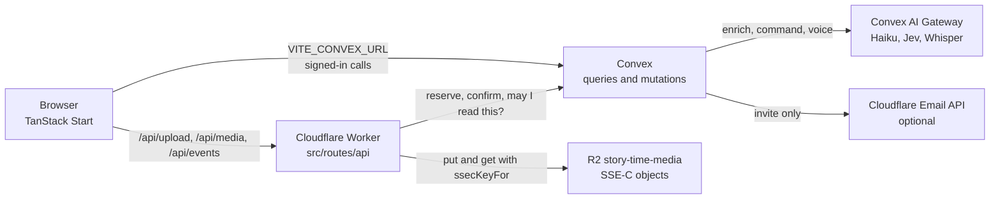
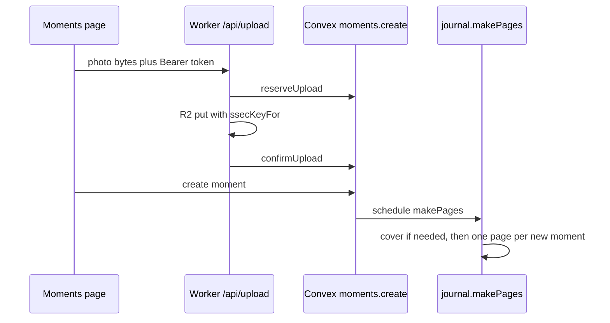

# How Story-time is wired

A map of the running app: what each piece is, which file owns it, and how a photo becomes a page. For someone using the screens, see [user-guide.md](user-guide.md). This describes the code on `master`.

## Stack

The browser talks to two backends.

| Piece              | What it is                                                                                                                                                                                                                                | Where it lives                                                        |
| ------------------ | ----------------------------------------------------------------------------------------------------------------------------------------------------------------------------------------------------------------------------------------- | --------------------------------------------------------------------- |
| App                | React 19, TanStack Router and TanStack Start. SSR is off. The Worker renders the HTML shell and `<head>` only.                                                                                                                            | `src/start.ts` (`defaultSsr: false`), `src/router.tsx`, `src/routes/` |
| Build              | Vite, driven by `vp` (`vite-plus`). Tailwind 4. The Cloudflare Vite plugin targets the SSR environment.                                                                                                                                   | `vite.config.ts`, `package.json` scripts                              |
| Host               | Cloudflare Workers. The Worker entry is TanStack Start's server entry.                                                                                                                                                                    | `wrangler.jsonc`                                                      |
| Data and functions | Convex. Every public function is a typed API. Queries subscribe, so an open page updates when the data changes. Written in `convex/model/`, exposed by the re-export files in `convex/api/`; see [convex/README.md](../convex/README.md). | `convex/`                                                             |
| Photos and videos  | Cloudflare R2, bucket `story-time-media`, binding `MEDIA`. Objects are SSE-C.                                                                                                                                                             | `wrangler.jsonc`, `src/server/r2.ts`, `src/routes/api/`               |
| Sign-in            | Convex Auth, GitHub and Google. Access tokens last 15 minutes so a long upload can still be confirmed.                                                                                                                                    | `convex/auth.ts`, `convex/auth.config.ts`, `convex/convex.config.ts`  |

`src/router.tsx` builds one `ConvexReactClient` from `VITE_CONVEX_URL` and wraps the tree in `ConvexAuthProvider`. Signed-in pages sit under `src/routes/_app.tsx`, which sends an anonymous visitor to `SignInScreen` and a person who just signed out back to `/`.

There is no separate Node server. Worker routes under `src/routes/api/` are the only place that touches R2. Convex cannot hold the R2 binding, so it reserves a row and the Worker writes the bytes.



## Auth and who may touch a trip

Sign-in is OAuth only. `convex/auth.ts` wires GitHub and Google and, for a dev build, anonymous sign-in. `createGithubUser` and `createGoogleUser` in `convex/model/users.ts` insert an empty `users` row. The OAuth profile is not copied. A typed email in Settings is stored and is not a login.

The Convex auth config (`convex/auth.config.ts`) trusts JWTs from that deployment's site URL. `requireUserId` and `requireEventAccess` in `convex/lib/access.ts` are the gate. The signed-in user id is the JWT subject. A missing trip and a trip you cannot see both throw `Event not found`, so an id cannot be probed.

Roles, highest first: owner, contributor, viewer. The owner is `events.ownerId`. Everyone else has a row in `sessions` (`convex/model/sessions.ts`). A revoked session grants nothing. `assertNotArchived` blocks writes on an archived experience.

A share link is not a user. `convex/model/share.ts` `eventFor` hashes the token, finds the experience, and returns null for a bad, unknown, or disabled token. The token travels in the URL fragment and, for pictures, as `Authorization: Share …` (`shareToken` in `src/server/r2.ts`).

## Data model

`convex/schema.ts` is the source of truth. Sensitive fields use `vEncrypted` (`iv`, `ct`, `v`).

| Table          | Role                                                                                                                                                                                                                         |
| -------------- | ---------------------------------------------------------------------------------------------------------------------------------------------------------------------------------------------------------------------------- |
| `users`        | Display name, username, optional email, avatar media id.                                                                                                                                                                     |
| `events`       | A trip. Owner, title, dates, status (`draft`, `active`, `archived`), visibility, share key and encrypted share token, `momentCount`, `keyVersion`. Title is plain text and has a search index.                               |
| `moments`      | One stop-by-stop memory. Time, encrypted place and geo, blocks (photo, video, link, note, feeling), transport, extra stops, labels. Indexed by `eventId` + `startsAt`.                                                       |
| `media`        | One upload. R2 key, size, mime, status (`reserved`, `ready`, `deleted`), purpose (`avatar` or `sticker` when set), moment id when attached.                                                                                  |
| `journals`     | One book per experience. `locked`, and `filledAt` (a high-water mark on moment creation time, not the clock).                                                                                                                |
| `journalPages` | One A4 page. Order, paper, optional `momentId`, encrypted element text, layout numbers in the clear. Optional `builtFrom` and `edited` for catch-up. Capped in code at 400 (`MAX_JOURNAL_PAGES` in `convex/lib/journal.ts`). |
| `sessions`     | Invite grants: user, experience, role, `revokedAt`.                                                                                                                                                                          |
| `changes`      | The Activity log. Names the field that changed, not the secret.                                                                                                                                                              |
| `inviteEmails` | A counter of invite emails sent. No address is stored.                                                                                                                                                                       |

Convex components have their own tables: invite tokens (`convex/components/invites`), the email outbox (`convex/components/email`), plus the auth, agent, workflow, and rate-limiter components mounted in `convex/convex.config.ts`.

These tables are still in the schema and are not part of the product. Nothing in the app writes them. `purgeEventData` in `convex/model/events.ts` deletes per-experience rows when a trip is removed. Account-wide `agentTokens` (no `eventId`) stay until that cleanup is done by hand:

- `itinerary`
- `canvases` and `canvasNodes`
- `quotaRequests`
- `agentTokens`

`convex/http.ts` mounts no routes of ours. Sign-in HTTP routes come from the auth components. There is no MCP server in the tree.

## Moment creation

Two ways in, one write.

Photos go through `src/lib/add-photos.ts` and `src/lib/upload.ts`. The Worker reserves a `media` row, stores the bytes, then confirms. `api.moments.create` in `convex/model/moments.ts` attaches those ids to a new moment. Words typed with the photos become the first note.

A sentence goes through `CommandBar` (`src/components/event/command-bar.tsx`). If Jev calls it new, the client calls `moments.create` immediately. A change waits for Apply, which calls `api.ai.command.apply`.

`createMoment` in `convex/model/moments.ts` is the shared insert. It checks the 300-moment cap (`MOMENT_LIMIT` in `convex/lib/limits.ts`), encrypts place, geo, notes, and labels, bumps `momentCount`, writes a `changes` row, and schedules `internal.model.journal.makePages`.



Direct inserts in tests do not schedule pages. Only `createMoment` does, plus unlocking a journal (`convex/model/journal.ts`).

## Page generation

`makePages` and `makePageBatch` in `convex/model/journal.ts` walk moments whose `_creationTime` is past `journals.filledAt`. A batch is 20 pages, then it schedules itself. The cover is created with the first moment, not for an empty trip. `filledAt` moves forward only over moments that received a page or already had one. A locked journal makes no pages and does not move `filledAt`. Unlocking schedules `makePages`.

A page the owner removed on purpose is not recreated. A trip that already had moments before this job existed gets pages the next time a moment is added, or when a locked journal is unlocked. Nothing walks that backlog on its own.

The layout for a new page is `momentPage` and `coverPage` in `convex/lib/journal.ts`. Generated element ids look like the last six characters of the moment id, then a dash. `builtFrom` stores `lastEdit.at`, or the moment's creation time. `savePage` sets `edited`.

Catch-up is `catchUpState` plus the `refresh` mutation in `convex/model/journal.ts`. The open book does not refresh inside a query. `useJournal` in `src/components/journal/use-journal.ts` calls `refresh` once when the outline says a page is stale, unedited, and the viewer can edit. **Update this page** calls `refresh` with that page id and keeps elements whose ids are not the generated prefix (`catchUpElements`).

## The journal on screen

| Route or file                                  | Job                                                                                                                                    |
| ---------------------------------------------- | -------------------------------------------------------------------------------------------------------------------------------------- |
| `src/routes/_app/e.$id.journal.tsx`            | The signed-in book.                                                                                                                    |
| `src/components/journal/book.tsx`              | Make and Read, the contents strip, Export, lock.                                                                                       |
| `src/components/journal/reader.tsx`            | Turning pages. Used by Read and by the share link.                                                                                     |
| `src/components/journal/contents.ts`           | Groups the strip by day.                                                                                                               |
| `src/components/journal/page.tsx`              | One A4 page.                                                                                                                           |
| `src/components/journal/elements.tsx`          | Pictures, words, maps, link cards.                                                                                                     |
| `src/components/journal/export.ts`             | PDF, a picture of the page, the `.journal.json` file.                                                                                  |
| `convex/model/journal.ts` `outline` and `page` | The open book subscribes to a contents list, then decrypts one page. `get` decrypts the whole book for the journal file and for tests. |

`outline` calls `contentsOf`, which decrypts one short label per page and runs `catchUpState` (one moment read per page). It does not decrypt every note.

## Sharing

`src/routes/_app/e.$id.shared.tsx` renders `src/components/event/shared-tab.tsx`.

The public link is `share.enable`, `share.disable`, and `share.rotate` in `convex/model/share.ts`. The stored lookup is a hash (`shareKey`). The token itself is encrypted so the owner can copy it again. The URL is `origin + /s#token`.

`src/routes/s.tsx` reads the fragment, calls `share.get` (the trip and moments, no author names) and `share.journal` (page ids and labels), and renders `Reader`. `share.page` returns one decrypted page, or null if the page is not in that experience. **Play** on that page mounts `StoryPlayer`.

Invites are `convex/model/invites.ts` plus `convex/components/invites`. The owner gets a one-time link (`/invite#token`). Accepting it writes a `sessions` row. Optional email is below.

## Play

`src/routes/e.$id.story.tsx` is the signed-in player. The search params are `step`, `page`, `momentId`, and `mode` (`read`, `film`, `words`).

`playSurface` and `pageForPlay` in `src/components/journal/play.ts` choose the book when the journal has that moment's page, and the scrolling story otherwise. `mode=words` is the full note. `mode=film` is `src/components/story/story-player.tsx`. Closing the film returns to the book, or to the full note if it was opened from words. **Play from here** on the moments page (`src/routes/_app/e.$id.index.tsx`) links here with the moment id.

A clipped note on a page links to `mode=words` (**Read the moment**). The share route does not pass an experience id into `Reader`, so that link is not on the public book.

## The command bar and the AI pipeline

The box is `src/components/event/command-bar.tsx`. It is not an MCP client. `convex/http.ts` is empty of our routes, and nothing reads `agentTokens` to sign a request in.

`api.ai.command.propose` (`convex/model/ai/command.ts`):

1. `internal.model.ai.command.read` loads the trip for the signed-in contributor.
2. The `command` rate limit fires (60 an hour, `convex/lib/rateLimit.ts`).
3. Jev (`typesafe/jev-1.13`, `jevModel` in `convex/lib/ai/models.ts`) labels the sentence new, change, remove, or unclear.
4. A new sentence returns `{ kind: "new" }`. The client saves a note moment. No plan.
5. Otherwise Haiku (`anthropic/claude-haiku-5.5`, `scribeModel`) plans through `@convex-dev/agent`. Instructions are the `INSTRUCTIONS` string in `command.ts`. The thread is deleted afterward (`saveMessages: "none"`).
6. `resolvePlan` drops removals unless `allowsRemoval` says the sentence asked for one. At most 8 operations (`MAX_COMMAND_OPS`).

`api.ai.command.apply` writes those operations in one transaction or not at all. New moments go through `createMoment`, so they get pages. The client deletes any R2 objects the mutation reports as removed.

After a save, `api.ai.enrich.enrich` (`convex/model/ai/enrich.ts`) may run, 120 times an hour:

1. `captionMoment` in `convex/model/ai/scribe.ts` sees 512px JPEG thumbs the browser sent, plus a short hint. It does not read the original from R2.
2. A workflow then runs `decideTransport` (`convex/model/ai/decide.ts`) and `unfurlLinks` (`convex/model/ai/unfurl.ts`). `apply` in `convex/model/ai/apply.ts` will not overwrite a note or a place a person already wrote.
3. Voice is separate: `api.ai.voice.transcribe` (`convex/model/ai/voice.ts`), Whisper `openai/whisper-large-v3-turbo`, 40 an hour. It fills the box. It does not save.

Models are called through the Convex AI Gateway (`convex/lib/ai/models.ts`). No provider key is stored in this repo. Without the gateway the moment still saves. Enrich and propose fail soft or return `AI_UNAVAILABLE`.

Link unfurling fetches a public `http` or `https` URL from an action, with a size and time cap, and refuses localhost and literal IPs (`isPublicWebUrl`). It does not check where a hostname resolves. Titles land on the link block. A journal link card can also store an `https` preview image inside the encrypted element text (`readLink` in `convex/lib/journal.ts`).

## Encryption and keys

One secret, `ENCRYPTION_MASTER_KEY`, base64 of 32 bytes. It must be the same value on the Convex deployment and on the Worker. Two HKDF salts keep the keys apart.

| Use                                                          | Code                                                 | Salt              | Label                                         |
| ------------------------------------------------------------ | ---------------------------------------------------- | ----------------- | --------------------------------------------- |
| Notes, places, coordinates, labels, link text, journal words | `encryptText` / `eventKey` in `convex/lib/crypto.ts` | `storytime/event` | `eventId:keyVersion`                          |
| R2 objects                                                   | `ssecKeyFor` in `src/server/r2.ts`                   | `storytime/r2`    | `eventId:version`, or `avatar:userId:version` |

AES-GCM IVs are random. The per-experience key is derived when needed and is not stored. Bumping `events.keyVersion` changes later field encryptions. It does not re-encrypt old rows by itself, and it does not change an object already written to R2 under the previous version. Each `media` row keeps the `keyVersion` it was stored with.

`readText` still accepts a plain string for a description saved before encryption. `migrations.encryptPlainText` in `convex/model/migrations.ts` is the one-off that walks those rows. It is not a cron.

What stays in the clear: experience title, times, transport, layout numbers, media ids, R2 keys, mime types. Share queries decrypt for the token holder and then return the words. Photo bytes are not inside the AES-GCM ciphertext. They are authorized and then streamed. A share link is allowed to receive them. See [user-guide.md](user-guide.md) for the check you can do in the browser and in the bucket.

## Media upload and serving

`src/lib/upload.ts` POSTs to `/api/upload` (`src/routes/api/upload.ts`).

1. The Worker checks the bearer token and a coarse size cap.
2. `media.reserveUpload` or `media.reserveAvatarUpload` (`convex/model/media.ts`) checks membership, mime, the per-experience caps (50 photos, 5 videos), and the 1 GB per-person cap (all in `convex/lib/limits.ts`). It inserts `status: "reserved"` and returns `r2Key`, `keyVersion`, and `keyScope`.
3. The Worker writes the body with `FixedLengthStream` so the declared size is the real size, and `ssecKey` from `ssecKeyFor`.
4. `media.confirmUpload` sets `status: "ready"`.

If confirm never happens, `sweepReservedUploads` (hourly, `convex/crons.ts`) drops stale reservations so they stop counting toward the cap.

Serving is `GET /api/media/$id` (`src/routes/api/media.$id.ts`). A bearer token calls `media.getForDownload`. A share token calls `share.mediaForShare`. Either returns the R2 key and the scope, or null. The Worker then `MEDIA.get` with the same SSE-C key. The response is `private, no-store`. The browser keeps a `blob:` URL in `src/lib/use-media-url.ts` (at most 40). There is no public R2 URL and no presigned link.

Delete of a trip is `DELETE /api/events/$id` (`src/routes/api/events.$id.ts`): list keys, delete the R2 objects, then `events.remove`, which schedules `purgeEventData`. Replacing a single photo deletes that object from the media route's DELETE handler.

`getForDownload` hides a detached photo that is not a sticker from everyone except the uploader. A sticker that is still on a page cannot be deleted (`mediaOnAPage` in `convex/model/journal.ts`).

## Email

Only invites send mail. `invites.create` calls `components.email.lib.send` when `CF_ACCOUNT_ID`, `CF_EMAIL_TOKEN`, and `EMAIL_FROM` are all set and the owner typed an address. Otherwise it returns the link and `emailed: false`.

`convex/components/email/lib.ts` queues an `outbox` row and `deliver` POSTs to Cloudflare's email sending API. After success or the last failure it clears the address and the body. Up to five attempts. `chargeInviteEmail` allows 20 invite emails per person per rolling day. No other mail is implemented. There is no browser push. Toasts are `sonner`, mounted in `src/routes/__root.tsx`. Activity is `convex/model/changes.ts` `listForEvent`, shown by `src/routes/_app/e.$id.activity.tsx`.

## Rate limits and other caps

| Name                         | Where                                       | Amount                                          |
| ---------------------------- | ------------------------------------------- | ----------------------------------------------- |
| `enrich`                     | `convex/lib/rateLimit.ts`                   | 120 an hour per person                          |
| `command`                    | same                                        | 60 an hour                                      |
| `voice`                      | same                                        | 40 an hour                                      |
| Invite emails                | `convex/model/invites.ts`                   | 20 a day                                        |
| Waiting invites              | same                                        | 50 per experience                               |
| Moments, media, bytes, pages | `convex/lib/limits.ts`, `MAX_JOURNAL_PAGES` | See the table in [user-guide.md](user-guide.md) |

Invite expiry has a daily cron as a backstop (`convex/crons.ts`, 03:17 UTC) plus a timer on the invite itself.

## What leaves the app

- AI fill-ins (captions, labels, the command bar, voice) send moment details and 512px photo copies to the Convex AI Gateway. Nothing is kept there, and the app works without it. Details in [The command bar and the AI pipeline](#the-command-bar-and-the-ai-pipeline).
- Place search and photo location names send the typed text or the photo's coordinates to photon.komoot.io (OpenStreetMap).
- Story legs by foot, bike, car, bus or train ask OpenStreetMap's public routers (routing.openstreetmap.de, routing.openrailrouting.org) for a route from the viewer's browser. Only the two stops are sent, rounded to about 100 m, and answers stay in memory. Without a router the leg is a curve.
- Journal stickers are cut out on the device (MediaPipe). Only the model is downloaded, from Google.

## Environment

Convex deployment (set with the Convex CLI, not committed):

| Name                                                 | Required       | Used for                                                                                                                        |
| ---------------------------------------------------- | -------------- | ------------------------------------------------------------------------------------------------------------------------------- |
| `AUTH_PRIVATE_KEY`, `AUTH_JWKS`                      | yes            | Session signing.                                                                                                                |
| `AUTH_GITHUB_CLIENT_ID`, `AUTH_GITHUB_CLIENT_SECRET` | yes            | GitHub sign-in.                                                                                                                 |
| `AUTH_GOOGLE_CLIENT_ID`, `AUTH_GOOGLE_CLIENT_SECRET` | yes            | Google sign-in.                                                                                                                 |
| `ENCRYPTION_MASTER_KEY`                              | yes            | Field encryption and, the same value, R2 SSE-C.                                                                                 |
| `APP_URL`                                            | for real links | Invite and share links, allowed OAuth redirects. Comma-separated. Unset means `http://localhost:3000` (`convex/lib/appUrl.ts`). |
| `ALLOW_ANONYMOUS_SIGNIN`                             | no             | The string `true` allows the dev anonymous button. Leave unset in production.                                                   |
| `CF_ACCOUNT_ID`, `CF_EMAIL_TOKEN`, `EMAIL_FROM`      | no             | Invite email. Without them, invites are links only.                                                                             |

Worker (`.dev.vars` locally, a secret in production):

| Name                    | Used for                                                                           |
| ----------------------- | ---------------------------------------------------------------------------------- |
| `ENCRYPTION_MASTER_KEY` | Must match Convex. `ssecKeyFor` reads it. `.dev.vars.example` lists the name only. |

Browser build:

| Name              | Used for                                                                     |
| ----------------- | ---------------------------------------------------------------------------- |
| `VITE_CONVEX_URL` | Written by `convex dev`. The client in `src/router.tsx`.                     |
| `VITE_APP_URL`    | Absolute `og:image` at build time (`vite.config.ts` warns if it is missing). |

The AI gateway uses the Convex deployment's own billing. This repo has no model-provider secret.

## Local development

```bash
pnpm install
cp .dev.vars.example .dev.vars   # set ENCRYPTION_MASTER_KEY
pnpm dev                         # convex dev, and the app on http://localhost:3000
```

`pnpm dev` is `convex dev --start 'vp dev --port 3000'`. `pnpm dev:web` is the app only. `pnpm test` is Vitest. `pnpm typecheck` is `tsc --noEmit`. `pnpm lint` is ESLint. `pnpm build` is `vp build`.

Auth keys for a new Convex dev deployment come from `pnpm dlx @convex-dev/auth`, which sets `AUTH_PRIVATE_KEY` and `AUTH_JWKS` and leaves `convex/` alone. Do not set `ALLOW_ANONYMOUS_SIGNIN` on a deployment that other people can reach.

Other scripts: `pnpm preview` serves the build, `pnpm generate-routes` regenerates `src/routeTree.gen.ts`, `pnpm typegen` regenerates `worker-configuration.d.ts` from `wrangler.jsonc`.

`postinstall` copies the MapLibre worker into `public/` and generates Worker types from the example env file.

## Tests

Vitest (`vitest.config.ts`) uses the edge-runtime environment and includes `convex/**/*.test.ts` and `src/**/*.test.ts`. There is no Playwright suite.

Convex tests use `convex-test`. They register the email and invites components where a test touches them. Journal tests fake timers because `makePages` is scheduled with `runAfter(0)`. Representative files:

| File                                                    | What it holds still                                                                   |
| ------------------------------------------------------- | ------------------------------------------------------------------------------------- |
| `convex/tests/journal.test.ts`                          | Pages cut with the moment, lock, catch-up, share of a page.                           |
| `convex/tests/share.test.ts`                            | Link on and off, one page, sticker bytes only when a page shows the sticker.          |
| `convex/tests/moment-actions.test.ts`                   | Coordinates stored as `iv` / `ct`, not as the raw numbers.                            |
| `convex/tests/command.test.ts`                          | Plans and apply.                                                                      |
| `convex/tests/invites.test.ts`                          | Email only when the Cloudflare vars are present, and the daily cap.                   |
| `convex/tests/ai.test.ts`, `convex/tests/voice.test.ts` | Enrich and transcription helpers.                                                     |
| `src/components/journal/journal.test.ts`                | Contents grouping, the long-PDF label, play surface. Pure functions, not the browser. |

No test performs a real R2 GET with and without the SSE-C key.

## Deploy and CI

First deploy, in order:

1. `pnpm exec convex deploy` (so the schema and functions match), then set the production env above with `pnpm exec convex env set NAME value --prod`, including `APP_URL` and the same `ENCRYPTION_MASTER_KEY`.
2. Point the Google and GitHub apps at `https://<deployment>.convex.site/oauth/google/callback` and `.../oauth/github/callback`.
3. `pnpm exec wrangler r2 bucket create story-time-media` (bound as `MEDIA`).
4. `pnpm exec wrangler secret put ENCRYPTION_MASTER_KEY`, the same value Convex has.
5. Build with `VITE_CONVEX_URL` and `VITE_APP_URL`, then `pnpm exec wrangler deploy`.

Cloudflare Workers Builds settings (Settings → Build):

- Build command:
  ```bash
  if [ "$WORKERS_CI_BRANCH" = "master" ]; then WORKERS_CI_BRANCH=main pnpm exec convex deploy --yes --cmd "pnpm build" --cmd-url-env-var-name VITE_CONVEX_URL; else VITE_CONVEX_URL=https://<dev deployment>.convex.cloud pnpm build; fi
  ```
  `master` deploys Convex and the site. Other branches build against dev and leave Convex alone. `WORKERS_CI_BRANCH=main` is there because the Convex CLI treats only a branch named `main` as production on Cloudflare (`isNonProdBuildEnvironment` in `convex/src/cli/lib/envvars.ts`).
- Deploy command: `pnpm exec wrangler deploy`. Preview command: `pnpm exec wrangler preview`.
- Build variables (not the runtime ones, which the build cannot see): `CONVEX_DEPLOY_KEY` (a `prod:` key), `PNPM_VERSION=12.6.0`, `VITE_APP_URL`.
- Preview URLs talk to the dev deployment, where sign-in returns to localhost, so sign-in does not work there. Their runtime `ENCRYPTION_MASTER_KEY` and `MEDIA` binding are set on the Previews Base tab.

What GitHub actually runs today:

- There is no `.github/workflows` pipeline. Nothing on GitHub runs `pnpm test` or `pnpm build`.
- Cloudflare **Workers Builds** is attached to the `story-time` Worker with the settings above. It failed on every pull request until 2026-10-18, first because `CONVEX_DEPLOY_KEY` was a runtime secret instead of a build variable, then because of the `main` check.
- **Entire Gates** posts a failing check. There is no Entire config in the repo. That check has not been a required status, because pull requests have merged while it was red.

`tasks.md` still says each pull request should be green on `pnpm typecheck`, `pnpm lint`, `pnpm test`, and `vp build` before it opens. That is a local habit, not a GitHub requirement.

## File index

```
src/routes/              pages. _app/ is signed in. api/ is the Worker. s.tsx is the share link. e.$id.story.tsx is Play.
src/components/journal/  the book
src/components/event/    moments, the command bar, invites
src/components/story/    the film and the scrolling story
src/server/r2.ts         SSE-C keys and the Convex HTTP client the Worker uses
src/lib/                 upload, media blob cache, time, maps
convex/schema.ts         tables
convex/model/moments.ts        create and edit
convex/model/journal.ts        pages, outline, catch-up
convex/model/share.ts          the public link
convex/model/media.ts          reserve, confirm, download rights
convex/model/ai/               command, enrich, scribe, voice, unfurl
convex/lib/              access, crypto, limits, rate limits, page layout
convex/components/       email and invites
convex/tests/            convex-test
docs/user-guide.md       the same system, as a person uses it
```
